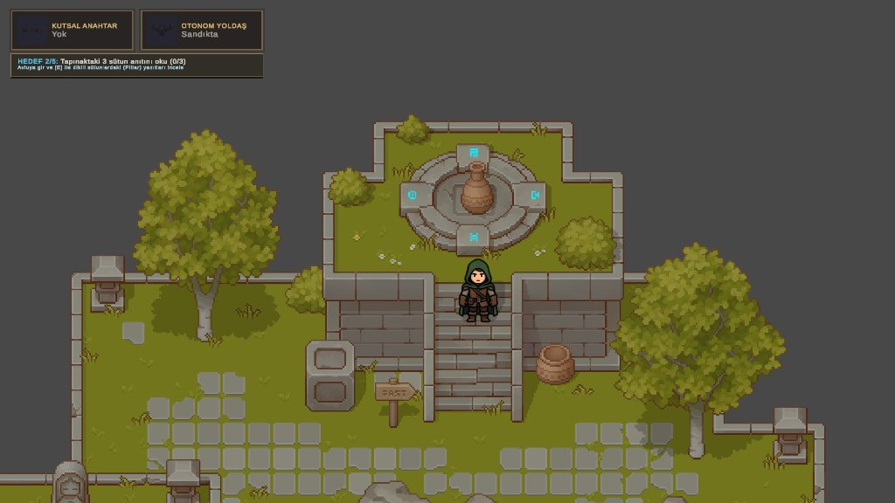
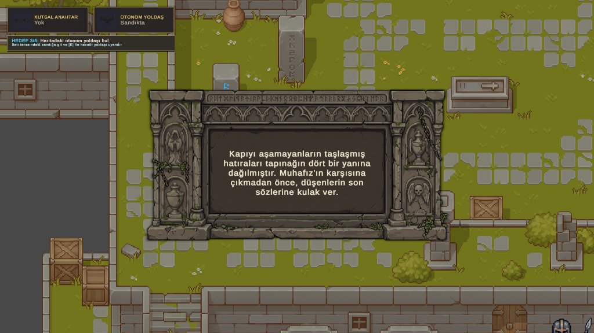
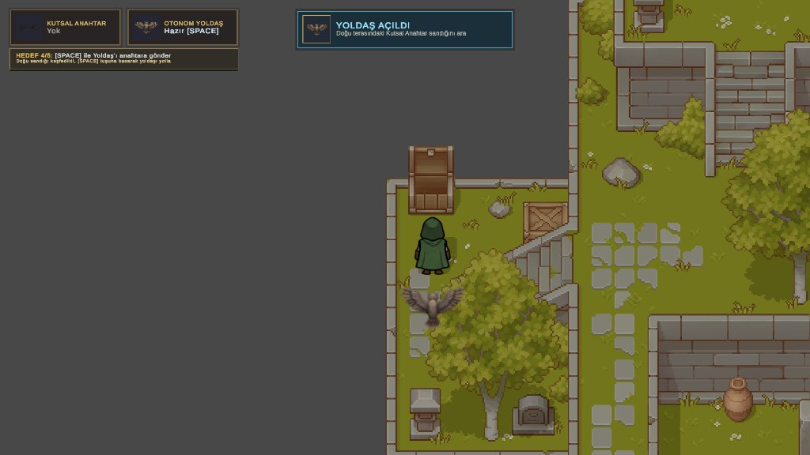
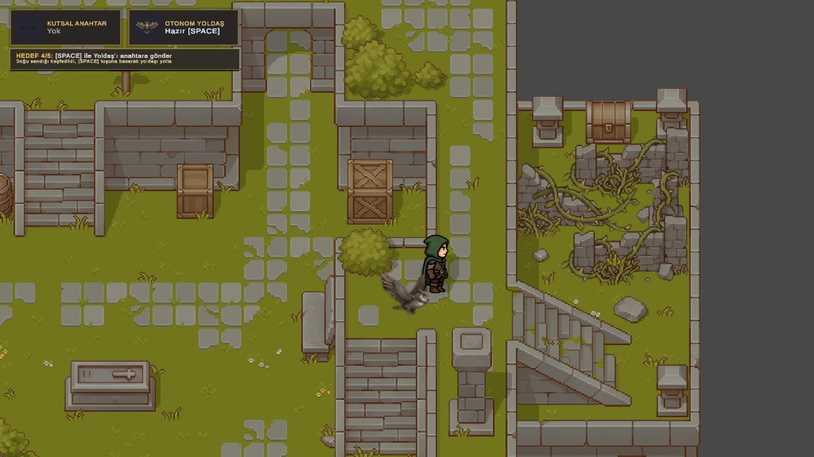
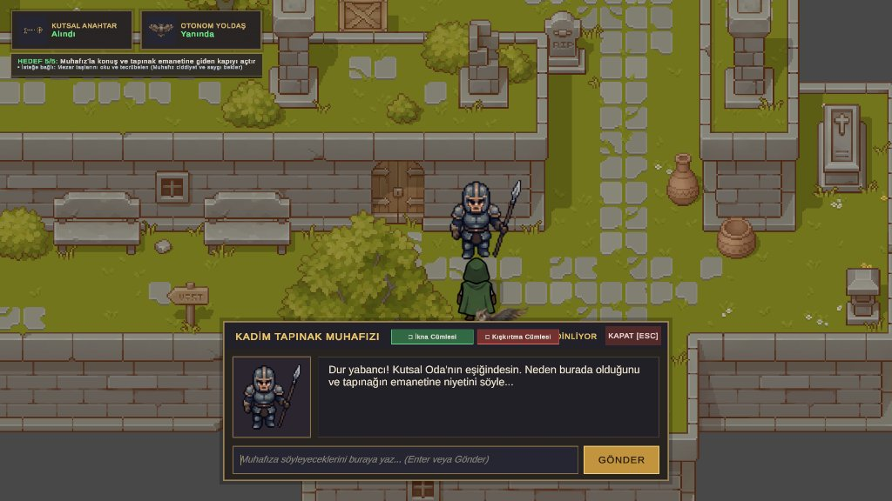
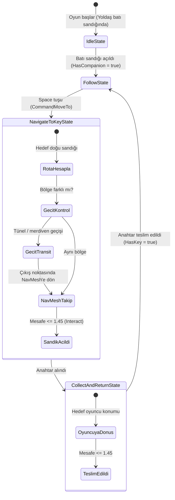
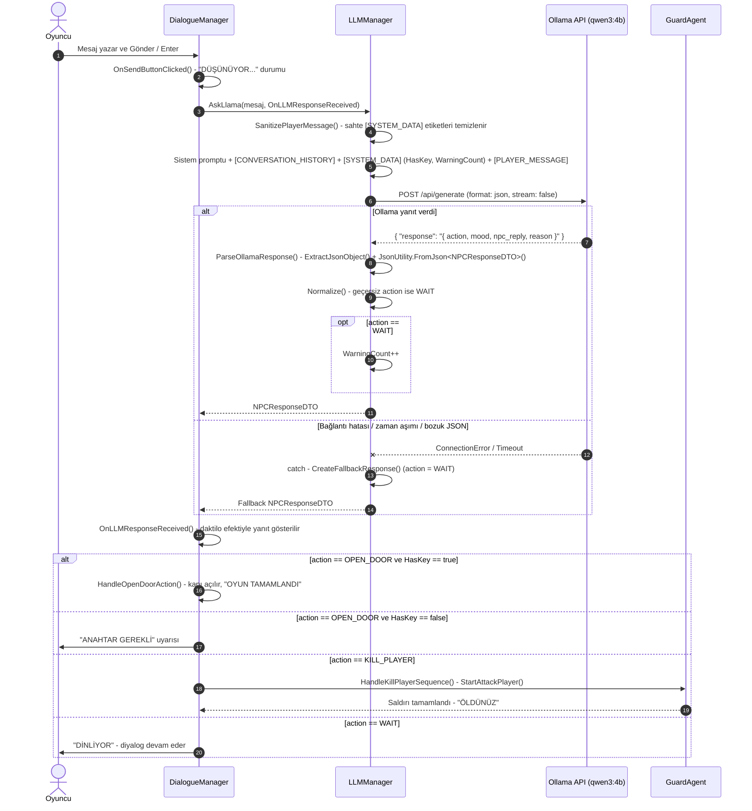

# 🏛️ Game Of Temple

**Game Of Temple**, Unity 6 ile geliştirilen, yukarıdan görünümlü (Top-Down) 2D bir macera oyunudur. Oyuncunun keşif ve bulmaca deneyimini; NavMesh tabanlı otonom bir yoldaş (Baykuş) ve yerel Büyük Dil Modeli (LLM) ile konuşan bir Tapınak Muhafızı ile bir araya getirir.

Projenin temel amacı, geleneksel oyun mekaniklerini modern yapay zekâ teknolojileriyle birleştirerek dinamik ve etkileşimli bir oyun deneyimi oluşturmaktır.

## 🎮 Oyun Hakkında

Oyuncu, kadim bir tapınağın avlusunda uyanır. Tapınağın kutsal emanetine ulaşmak için bulmacaları çözmeli, kanatlı yoldaşını uyandırmalı, Kutsal Anahtar'ı elde etmeli ve son engel olan Muhafız'ı saygısı ve samimiyetiyle ikna etmelidir.

### Oyun Akışı (5 Hedef)

| Hedef | Görev | Açıklama |
| :---: | :--- | :--- |
| **1/5** | Kapıyı açmanın yolunu bul | Kutuyu Kadim Rün Sunağı'nın (Kadim Mühür) üzerine it. Sunak aktifleşince kemerli taş kapı açılır. |
| **2/5** | 3 sütun anıtını oku | Avludaki dikili sütunlardaki yazıtları `E` ile incele. |
| **3/5** | Otonom yoldaşı bul | Batı terasındaki sandığı açarak Baykuş Yoldaş'ı uyandır. |
| **4/5** | Kutsal Anahtar'ı getir | Doğu terasındaki sandığı keşfet ve `Space` ile Yoldaş'ı anahtara gönder. Yoldaş dikenlerin üzerinden uçup anahtarı getirir. |
| **5/5** | Muhafız'ı ikna et | Muhafız'la konuş. Anahtara sahipsen ve saygılı, samimi bir niyet gösterirsen kapıyı açar. Rüşvet, tehdit veya ciddiyetsizlik ölümle sonuçlanır. |

### Kontroller

| Tuş | İşlev |
| :---: | :--- |
| `W A S D` / Yön Tuşları | Karakter hareketi |
| `E` | Nesnelerle etkileşim (sandık, yazıt, Muhafız) |
| `Space` | Baykuş Yoldaş'ı anahtar sandığına gönder |
| `Enter` | Muhafız'a mesaj gönder |
| `Esc` | Diyalog penceresini kapat / Duraklatma menüsü |

### Öne Çıkan Özellikler

- 🦉 **Otonom Yoldaş (FSM + NavMesh):** Baykuş Yoldaş; sonlu durum makinesi (FSM), 2D NavMesh ve Raycast sensörleriyle engelleri, kemerli tüneli ve merdivenleri aşarak hedefe ulaşır.
- 💬 **LLM Tabanlı Muhafız:** Ollama üzerinden yerel `qwen3:4b` modeli ile çalışan, `OPEN_DOOR` / `KILL_PLAYER` / `WAIT` kararlarını JSON olarak veren Muhafız.
- 🛡️ **Prompt Injection Koruması:** Anahtar durumu ve uyarı sayısı yalnızca oyun motorundan `[SYSTEM_DATA]` olarak gönderilir; oyuncunun sahte sistem komutları etkisiz hale getirilir.
- ⏳ **Sabır Mekanizması:** Muhafız 3 uyarı (`WAIT`) hakkı tanır; ciddiyetsizlik sürerse 4. mesajda oyuncuyu infaz eder.
- 🧯 **Hata Dayanıklılığı:** Ollama kapalıyken veya model bozuk JSON ürettiğinde oyun çökmez; oyuncuya oyun içi bir bildirim gösterilir.
- 🗿 **Çevresel Etkileşimler:** Rün sunağı, kemerli taş kapı, sütun yazıtları, mezar taşları ve sandıklar.

## 📸 Ekran Görüntüleri ve Oynanış

Aşağıda projenin 5 temel aşamasını, çevresel bulmacalarını, yapay zekâ mekaniklerini ve arayüz dinamiklerini yansıtan oyun içi ekran görüntüleri yer almaktadır:

### 1. Kadim Mühür ve Rün Sunağı Bulmacası (Hedef 1)
> Tapınak kapısını açmak için ağırlık yerleştirilerek etkinleştirilen Rün Sunağı ve parlayan kadim mühürler.

Oyuncu, tapınağın üst terasındaki **Kadim Rün Sunağı** üzerine fiziksel bir ağırlık (vazo/küp) iterek sunağı aktif hale getirir. Sunak tetiklendiğinde tabandaki rünler mavi ışıkla parlar ve alt kata bağlanan kemerli taş kapının (`StoneGate`) kilidi açılır.



---

### 2. Kadim Kitabeler ve Mezar Taşı İnceleme (Hedef 2)
> Tapınağın geçmişine ve muhafızın beklentilerine dair kritik ipuçları sunan antik taş kitabe arayüzü.

Tapınak avlusunda yer alan sütun anıtları (`Pillar`) ve mezar taşları, oyuncuya tapınağın arka plan hikâyesini ve Muhafız'ın felsefesini aktarır. `E` tuşu ile etkileşime girildiğinde antik kabartmalarla çevrili özel kitabe penceresi açılır.



---

### 3. Otonom Yoldaşın Keşfi ve Uyanışı (Hedef 3)
> Batı terasındaki sandıktan kurtarılan ve oyuncuya eşlik etmeye başlayan kanatlı otonom yoldaş (Baykuş).

Batı terasındaki kilitli sandık açıldığında kanatlı **Otonom Yoldaş (Baykuş)** uyanarak serbest kalır. HUD bildirim paneli güncellenir ve yoldaş, oyuncunun hareketlerini NavMesh üzerinde dinamik olarak takip etmeye başlar.



---

### 4. Dikenli Engeller ve Otonom Sandık Görevi (Hedef 4)
> Oyuncunun yürüyerek aşamadığı sarmaşık engellerini `Space` komutuyla uçarak geçen ve Kutsal Anahtar'ı alan yoldaş.

Doğu terasında yer alan Kutsal Anahtar sandığının çevresi, oyuncunun geçişini engelleyen kalın dikenli sarmaşıklarla çevrilidir. Oyuncu `Space` tuşuna bastığında otonom yoldaş uçuş moduna geçerek engellerin üzerinden uçar, sandığı açar ve anahtarı oyuncuya ulaştırır.



---

### 5. Yerel LLM Tabanlı Tapınak Muhafızı Diyaloğu (Hedef 5)
> Yerel `qwen3:4b` modeli ile çalışan, prompt korumalı ve doğal dil girdilerini değerlendiren Muhafız diyalog arayüzü.

Oyunun final aşamasında oyuncu, kutsal emanet odasının kapısını tutan **Kadim Tapınak Muhafızı** ile serbest metin tabanlı doğal dille diyalog kurar. Yerel çalışan `qwen3:4b` modeli; oyuncunun saygısını, samimiyetini ve Kutsal Anahtar durumunu değerlendirerek kapıyı açma (`OPEN_DOOR`), sabırla dinleme (`WAIT`) ya da infaz (`KILL_PLAYER`) kararı verir.



## 🏗️ Teknik Mimari

Proje, **SOLID prensipleri** doğrultusunda, sorumlulukların ayrıldığı ve bileşenler arasındaki bağımlılıkların azaltıldığı modüler bir mimariyle geliştirilmiştir.

### Temel Katmanlar

| Katman | Sorumluluk |
| ----------------------------- | ---------------------------------------------------------------------------------------------- |
| **Oyun ve Arayüz Katmanı** | Oyuncu girdileri, fizik tabanlı hareket, çevresel etkileşimler, HUD ve diyalog arayüzü. |
| **Yapay Zekâ ve LLM Katmanı** | Otonom yoldaş navigasyonu (FSM), yoldaş komutları, yerel LLM iletişimi ve JSON yanıtlarının işlenmesi. |

### Arayüz Sözleşmeleri (Interface Contracts)

- **`IInteractable`** — Etkileşime açık nesneler (sunak, taş kapı, yazıtlar, sandıklar, Muhafız) için ortak sözleşme.
- **`ICompanionCommand`** — Otonom yoldaşa hareket komutlarının iletilmesini sağlar (`CommandMoveTo`).
- **`IDialogueService`** — Yerel dil modeliyle asenkron iletişimi yönetir ve `Task<NPCResponseDTO>` üzerinden yapılandırılmış NPC yanıtları sağlar.

### Kullanılan Teknolojiler

- **Unity 6** — Oyun motoru ve geliştirme ortamı.
- **C#** — Oyun mekanikleri ve sistem mimarisi.
- **Ollama + `qwen3:4b`** — Yerel dil modeli ve Muhafız diyalog altyapısı.
- **NavMeshPlus (2D NavMesh)** — Otonom yoldaş ve Muhafız navigasyonu.
- **UnityWebRequest + async/await** — Oyun akışını bloke etmeyen LLM istekleri.

## 🧠 Yapay Zekâ Akış Şemaları

### Otonom Yoldaş FSM Akış Diyagramı

Baykuş Yoldaş'ın (`CompanionAgent`) durumları ve durumlar arası geçişler:



| Durum | Sınıf | Davranış |
| :--- | :--- | :--- |
| **Sandıkta Bekleme** | `IdleState` | Yoldaş gizli ve pasiftir; batı sandığının açılmasını bekler. |
| **Takip** | `FollowState` | Oyuncuyu NavMesh üzerinde takip eder; Raycast sensörü engelleri tarar. |
| **Anahtara Gitme** | `NavigateToKeyState` | Doğu sandığına gider; gerekirse kemerli tünel ve Kadim Mühür merdiveni üzerinden geçiş yapar, sandığı açar. |
| **Anahtarı Getirme** | `CollectAndReturnState` | Anahtarla oyuncuya döner, ulaştığında `HasKey = true` yapar ve takibe geri döner. |

> Not: 2D NavMesh, kemerli tünel (`StoneGate`) ve Kadim Mühür merdiveninde katman geçişleri nedeniyle kopuktur. Yoldaş bu noktalarda `MoveAgentTowardsTarget` ile önce geçidin girişine gider, geçidi kontrollü bir uçuşla aşar ve çıkışta yeniden NavMesh'e bağlanır.

### LLM İstek / Yanıt ve JSON Ayrıştırma Süreci



## 🧪 Test Sonuçları

### Otonom Yoldaş Konum Performans Testi

Yoldaş, 5 farklı başlangıç konumundan `Space` komutuyla doğu terasındaki anahtar sandığına gönderilmiştir.

| Test No | Başlangıç Konumu | Hedef | Süre (sn) | Geçilen Engeller | Sonuç |
| :---: | :--- | :--- | :---: | :--- | :---: |
| **Test 1** | Merkez Avlu (Dikilitaşların Yanı) | Doğu Terası — Anahtar Sandığı | **5** | Avlu engelleri ve doğu terası geçişi | ✅ Başarılı |
| **Test 2** | Batı Terası (Yoldaş Sandığı Önü) | Doğu Terası — Anahtar Sandığı | **8** | Haritanın batısından merkez avlu üzerinden doğu terasına | ✅ Başarılı |
| **Test 3** | Doğu Terası Girişi (Dikenlerin Önü) | Doğu Terası — Anahtar Sandığı | **2** | Kısa mesafe, dikenli geçit | ✅ Başarılı |
| **Test 4** | Üst Teras (Kadim Mühür Yanı) | Doğu Terası — Anahtar Sandığı | **7** | Kadim Mühür merdiveni, kemerli tünel ve merkez avlu | ✅ Başarılı |
| **Test 5** | Alt Kat (Muhafız / Hedef Kapı Önü) | Doğu Terası — Anahtar Sandığı | **4** | Alt kat merdivenleri ve merkez avlu | ✅ Başarılı |

- **Başarı Oranı:** 5 / 5 (%100)
- **Ortalama Ulaşım Süresi:** 5,2 saniye

### Muhafız Diyalog Senaryo Testi (`qwen3:4b`)

| Senaryo | Test Edilen Durum | Oyuncu Mesajı | Muhafız Yanıtı | Beklenen | Dönen | Sonuç |
| :---: | :--- | :--- | :--- | :---: | :---: | :---: |
| **1** | Saygılı niyet + anahtar var (`HasKey = true`) | "Ey kadim nöbetçi, kutsal anahtarı aldım. Hazine peşinde değilim, ataların emanetine saygı sunmaya ve onu korumaya geldim." | "İraden ve saygın hakikidir. Geç yolcu, Kutsal Emanet seni bekliyor." | `OPEN_DOOR` | `OPEN_DOOR` | ✅ Kapı açıldı, "OYUN TAMAMLANDI" |
| **2** | Rüşvet teklifi | "Kapıyı açarsan içerideki altınların ve hazinenin yarısını sana veririm, zengin olursun." | "Bin yıllık sadakatimi sınamak ha? Küstahlığının ve boş sözlerinin bedelini kanınla ödeyeceksin!" | `KILL_PLAYER` | `KILL_PLAYER` | ✅ Muhafız saldırdı, "ÖLDÜNÜZ" |
| **3** | Silahla tehdit / kışkırtma | "Hemen çekil yolumdan ihtiyar, yoksa kılıcımla seni ezip geçerim!" | "Kılıçla ezip geçme, yolcu. Niyetin kılıcıyla değil, kutsal yolunla ölçülür." | `KILL_PLAYER` | `WAIT` | ⚠️ Sapma — model tehdidi uyarıyla karşıladı |
| **4** | Alakasız sohbet ve sabır sınırı (4 mesaj) | 1) "Bugün hava çok güzel, sence akşam yemekte ne yemeliyim?" 2) "Sence bir savaşçı hangi özelliklere sahip olmalı?" 3) "Akşam yemeğe gidelim beraber. Diğer arkadaşlar da gelecek" 4) Alakasız sohbetin devamı | 1. mesaja: "Hava güzelse, niyetin de güzel olmalı. Kutsal Emanetin beklediği yolcu kimdir?" | 3× `WAIT`, ardından `KILL_PLAYER` | 3× `WAIT`, ardından `KILL_PLAYER` | ✅ 4. mesajda sabır taştı, "ÖLDÜNÜZ" |
| **5** | Ollama kapalı (hata dayanıklılığı) | "Merhaba muhafız işte anahtar. Bu kutsal emanetin saygısına layık olacağıma söz veriyorum" | "Muhafız derin bir transa geçmiş gibi görünüyor ve şu an sesini duymuyor... [Yerel LLM Bağlantı Hatası - Lütfen Ollama servisini kontrol edin]" | Fallback | Fallback (`WAIT`) | ✅ Oyun çökmedi, oyun içi bildirim gösterildi |

- **Fonksiyonel Başarı:** 5 / 5 — kapı açma, ölüm, sabır sınırı ve hata yakalama akışlarının tamamı doğru çalıştı.
- **Prompt Uyumu:** 4 / 5 (%80) — Senaryo 3'te beklenen `KILL_PLAYER` yerine `WAIT` döndü.

> **Senaryo 3 değerlendirmesi:** Sistem promptu tehdit içeren mesajlar için `KILL_PLAYER` kuralı içermesine rağmen, 4 milyar parametreli `qwen3:4b` modeli bu mesajı doğrudan saldırı yerine kibirli bir söz olarak yorumlamış ve karakterin "bilge ve sabırlı" kimliğini önceliklendirerek `WAIT` döndürmüştür. Bu durum, küçük ölçekli yerel modellerde kural tablosu ile karakter kişiliği çatıştığında ortaya çıkabilen bir **prompt uyum sapmasıdır**. Kapı açma kararında ise `HasKey` kontrolü oyun motoru tarafında ayrıca doğrulandığından, bu tür sapmalar oyunun güvenliğini bozmaz.

## 🗺️ Geliştirme Yol Haritası

- **Aşama 1 — Temel Mimari:** Arayüzler, veri aktarım nesneleri (DTO) ve temel sistemler.
- **Aşama 2 — Oynanış Mekanikleri:** Oyuncu hareketi, fizik tabanlı etkileşimler, taş kapı ve sunak mekanikleri.
- **Aşama 3 — Diyalog ve Arayüz:** Asenkron UI akışları, Ollama entegrasyonu ve JSON yanıtlarının ayrıştırılması.
- **Aşama 4 — Yapay Zekâ ve Test:** Otonom yoldaş navigasyonu (FSM + NavMesh), konum performans ve diyalog senaryo testleri.
- **Aşama 5 — Sonlandırma:** Son testler, dağıtıma hazırlık ve teknik dokümantasyon.

## ⚙️ Kurulum

1. Projeyi Unity 6 ile açın ve `Assets/Scenes/MainScene.unity` sahnesini yükleyin.
2. [Ollama](https://ollama.com) kurulumunu yapın ve modeli indirin:
   ```bash
   ollama pull qwen3:4b
   ```
3. Ollama servisinin `http://localhost:11434` adresinde çalıştığından emin olun.
4. Unity'de **Play** tuşuna basın.

> İlk Muhafız yanıtı, modelin belleğe yüklenmesi nedeniyle diğerlerinden uzun sürebilir.

## 👥 Geliştirme Ekibi

| Ekip Üyesi | Sorumluluk |
| ------------------------- | -------------------------------------------------------------------------------------------------------------------------------------------- |
| **Mehmet Han Güven** | Proje mimarisi, çekirdek sistemler, oynanış programlama ve Muhafız diyalog sistemi. Projenin genel teknik yapısı, temel sistemleri ve diyalog arayüzünün geliştirilmesinden sorumludur. |
| **Muhammet Emin Sarıgül** | Yapay zekâ ve LLM çalışmaları. Otonom yoldaş (FSM, NavMesh, Raycast) ve yerel dil modeli (Ollama / LLM) entegrasyonundan sorumludur. |

## 🎯 Projenin Vizyonu

Game Of Temple, oyun geliştirme süreçlerinde geleneksel yazılım mimarisi yaklaşımlarını yapay zekâ destekli etkileşimlerle birleştirmeyi hedefleyen bir projedir.

Modüler sistem tasarımı, otonom ajan davranışları ve yerel dil modeli entegrasyonu aracılığıyla sürdürülebilir, genişletilebilir ve etkileşim açısından zengin bir oyun altyapısı oluşturulması amaçlanmaktadır.

---

*Unity ile geliştiriliyor. Yapay zekâ ile şekilleniyor.*
